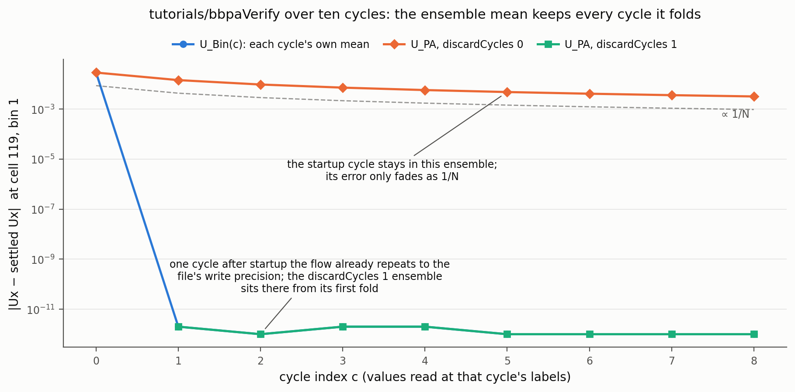

# 07 — The cycle window: `discardCycles` and `maxCycles`

Two entries bound which cycles enter the ensemble.

```c
discardCycles   1;    // skip the first N cycles (default 0)
maxCycles       -1;   // stop after N kept cycles; -1 = unlimited (default)
```

## `discardCycles`

A simulation started from rest spends its first cycle (or more) in a
startup transient. Folding that cycle into the ensemble would
contaminate every statistic with it. `discardCycles N` drops the first
`N` cycles completely: they are never accumulated, so they leave no
product files at all.

The old spelling `startCycle` is deprecated (same meaning, renamed for
clarity: the value counts discarded cycles).

`study_d07a_discard_cycles` discards one cycle of five:

<!-- demo:study_d07a_discard_cycles -->
```text
demo: study_d07a_discard_cycles
chapter: 07-cycle-window.md

case: study_d07a_discard_cycles  (endTime 5, solver writeInterval 1)
BBPA dictionary body:
    fields          (U);
    period          1.0;
    nBins           8;
    discardCycles   1;
    phaseOrigin     0;
    executeControl  timeStep;
    executeInterval 1;
    writeControl    writeTime;
run: completed

    file                  dirs  first    last
    U_Bin                    0  -        -
    U_Bin_UU                 0  -        -
    U_PA                    32  1        4.875
    U_PAVarianceMag         24  2        4.875
    U_PA_UU                 32  1        4.875
    U_PAmeanState            0  -        -
    uniform/*Properties      6
folded cycles at the newest checkpoint: U=4
deprecation warnings in the log: 0
```

Against the baseline's 40 directories, `U_PA` now spans 32 starting at
`1/`: cycle 0's labels (`0 … 0.875`) hold nothing, and the ensemble
counts 4 folded cycles. An absent directory is the visible signature
of a discarded cycle.

## What discarding buys: a convergence picture



This runs the chapter-01 tutorial for ten cycles, twice, and tracks
the distance from the settled flow (the last cycle's own `U_Bin`) at
the liveliest cell. In this laminar case each cycle's own `U_Bin` has
settled to the file's write precision one cycle after startup (blue).
The ensemble that folded the startup cycle never recovers within the
run: averaging dilutes that first error by 1/N per cycle, so after
nine cycles it still sits near 10⁻³ (orange, on the 1/N guide).
Discarding one cycle puts the ensemble at the precision floor from
its first fold (green). The ensemble mean is only as clean as the
worst cycle it keeps.

Regenerate with `python3 plot_convergence.py` (needs OpenFOAM; the
two ten-cycle runs take about a minute together and are reused when
already on disk).

## `maxCycles`

`maxCycles N` freezes the ensemble after `N` kept cycles. Steps in
later cycles are still classified and are then thrown away; the
statistics stop moving.

`study_d07b_max_cycles` keeps 2 of the 5 cycles:

<!-- demo:study_d07b_max_cycles -->
```text
demo: study_d07b_max_cycles
chapter: 07-cycle-window.md

case: study_d07b_max_cycles  (endTime 5, solver writeInterval 1)
BBPA dictionary body:
    fields          (U);
    period          1.0;
    nBins           8;
    discardCycles   0;
    phaseOrigin     0;
    maxCycles       2;
    executeControl  timeStep;
    executeInterval 1;
    writeControl    writeTime;
run: completed

    file                  dirs  first    last
    U_Bin                    0  -        -
    U_Bin_UU                 0  -        -
    U_PA                    40  0        4.875
    U_PAVarianceMag         32  1        4.875
    U_PA_UU                 40  0        4.875
    U_PAmeanState            0  -        -
    uniform/*Properties      6
folded cycles at the newest checkpoint: U=2
deprecation warnings in the log: 0
```

The file pattern looks identical to the baseline: `U_PA` in 40
directories, through `4.875/`. The tell is the checkpoint line,
`folded cycles: U=2`. After cycle 1 folded, every later dump re-dumps
the same frozen two-cycle ensemble at that cycle's labels. Use the
`nCycles` entry in `uniform/bbpaProperties` (or the log) to know how
many cycles a file actually averages; the directory time alone does
not say.
